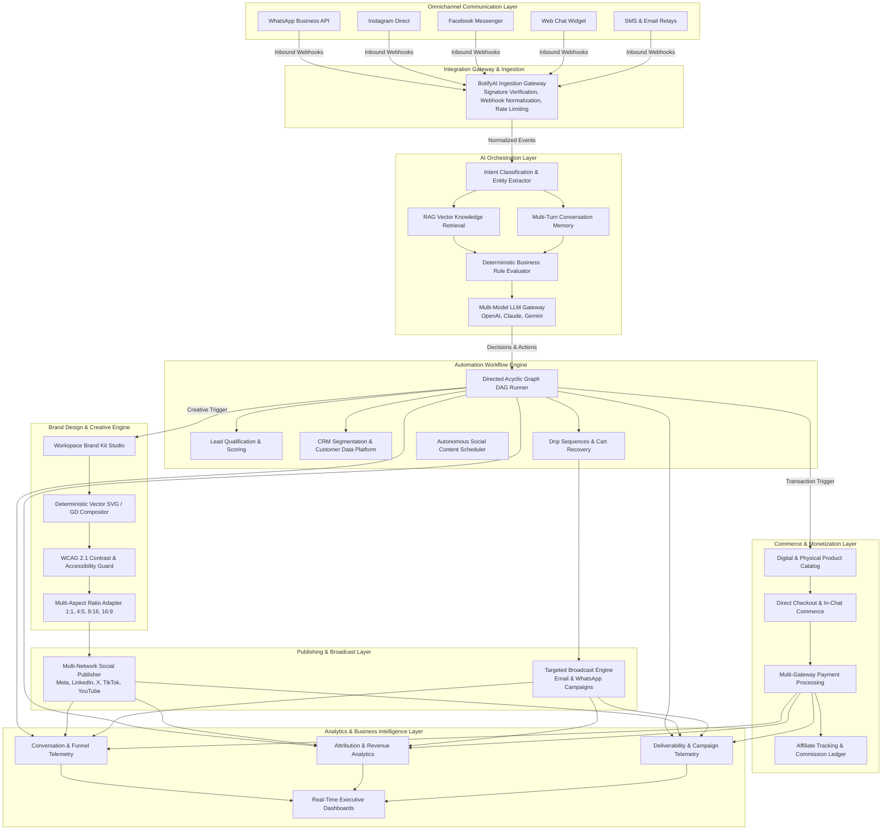

# BotifyAI.cloud

> **AI-Powered Business Automation & Social Commerce Infrastructure Platform**  
> *A proprietary enterprise platform developed and operated by **WAJO Limited**.*

[](https://botifyai.cloud)
[](#system-architecture)
[](https://laravel.com)
[](https://react.dev)
[](https://www.mysql.com)
[](#intellectual-property--governance)

---

## Executive Summary

**BotifyAI.cloud** is an enterprise-grade **AI Business Automation and Social Commerce Infrastructure Platform** engineered to automate end-to-end customer engagement, conversational commerce, multi-channel marketing, and sales operations. 

BotifyAI is fundamentally **not** a basic chatbot wrapper or single-prompt conversational interface. It is a comprehensive business operating infrastructure that unites:

1. **Omnichannel Messaging Gateways** (WhatsApp Business API, Instagram Direct, Facebook Messenger, Web Chat, SMS, Email).
2. **Context-Aware AI Orchestration** (multi-turn memory, intent classification, Retrieval-Augmented Generation [RAG], and deterministic business decision logic).
3. **Autonomous Workflow Automation** (visual node-based execution DAGs, CRM synchronisation, lead scoring, and abandoned cart recovery).
4. **Native Social Commerce Infrastructure** (digital product catalogs, checkout flows, multi-currency transaction processing, affiliate networks, and automated commission ledgers).
5. **Deterministic Brand Design Engine** (on-the-fly vector graphic generation, brand identity kits, WCAG contrast verification, and multi-network automated publishing).
6. **Unified Analytics & Attribution Intelligence** (conversational funnel analytics, revenue attribution, deliverability metrics, and campaign performance).

By embedding advanced artificial intelligence directly into the business logic, database transactions, and messaging pipelines, BotifyAI empowers merchants, enterprises, and agencies to transform passive customer conversations into automated revenue pipelines.

---

## Intellectual Property, Provenance & Project History

> ### Notice for Technical Evaluators, Investors and partners
> **BotifyAI.cloud** was conceived, architected, and commercially deployed as proprietary intellectual property by **WAJO Limited** prior to the publication of selected code components on GitHub.
>
> - **Product Genesis**: Initial research, architectural design, and platform engineering commenced in **early 2024**.
> - **Commercial Operation**: The platform entered live commercial production in **December 2024**, processing real-world business transactions, customer conversations, and automated sales funnels.
> - **Repository Provenance**: BotifyAI was built as a private commercial asset. The public repository was created subsequently to facilitate technical documentation, architectural auditing, continuous integration, and transparent developer reference.
> - **Date Discrepancy Note**: The creation timestamp of this GitHub repository represents the date of public source synchronization and documentation, **not** the initial creation date of the underlying software, system architecture, or commercial platform.

```
 2024 Q1 - Q3                2024 Q4 (Dec)                 2025                       2026
 ┌──────────────────────┐    ┌──────────────────────┐     ┌──────────────────────┐    ┌──────────────────────┐
 │ Product Research     │    │ Commercial Launch    │     │ Ecosystem Expansion  │    │ Technical Audit &    │
 │ Architecture Design  │───>│ BotifyAI.cloud Live  │────>│ Multi-channel Growth │───>│ GitHub Documentation │
 │ Core Engine Build    │    │ Live Business Users  │     │ Commerce & Affiliate │    │ Brand Design Engine  │
 └──────────────────────┘    └──────────────────────┘     └──────────────────────┘    └──────────────────────┘
```

### Detailed Project Timeline

* **2024 (Inception & Core Engineering)**:
  * Feasibility analysis, market requirement synthesis, and domain-driven architectural planning.
  * Engineering of the core multi-tenant backend architecture on Laravel and MySQL.
  * Implementation of event-driven webhook ingestion pipelines for WhatsApp Cloud API and Meta Graph APIs.
  * Development of the foundational node-based automation engine and multi-turn state management.
  * Internal beta testing, stress testing of concurrent queue workers, and enterprise security hardening.

* **December 2024 (Commercial Production Launch)**:
  * Official commercial release of **BotifyAI.cloud** to businesses and digital merchants.
  * Deployment of live customer-facing storefronts, automated support pipelines, and transactional messaging.
  * Onboarding of foundational business accounts across retail, digital education, SaaS, and professional services.

* **2025 (Scale, Commerce & Ecosystem Expansion)**:
  * Introduction of the native digital commerce module: catalog management, self-hosted checkout, and automated product fulfillment.
  * Release of the multi-tier affiliate tracking engine with automated ledger balance accounting.
  * Integration of multi-model LLM gateways (OpenAI, Anthropic Claude, Google Gemini) with dynamic model routing and fallback mechanisms.
  * Expansion of marketing broadcast infrastructure, lead qualification pipelines, and CRM segmentation.

* **2026 (Advanced Creative Automation & Source Documentation)**:
  * Publication of selected engineering components on GitHub for architectural transparency, integration verification, and technical auditing.
  * Architecture and implementation of the **Deterministic AI Brand Design Engine** for automated, branded social creative generation.
  * Continuous optimization of multi-tenant isolation, enterprise rate limiting, and observability telemetry.

---

## System Architecture

BotifyAI is designed as a modular, event-driven, multi-tenant distributed system. Interactions flow through tightly decoupled architectural layers that ensure isolation, fault tolerance, and deterministic execution.



---

## In-Depth Architectural Layers

### 1. Omnichannel Communication Layer
The communication tier normalizes incoming messages and events from fragmented third-party protocols into a standardized event payload:
* **WhatsApp Cloud API**: Direct enterprise integration supporting interactive list messages, quick-reply buttons, media messages, and template messaging.
* **Meta Graph API (Instagram & Facebook)**: Webhook handling for Direct Messages, Story mentions, post comment auto-replies, and Messenger conversations.
* **Real-Time Web Chat Widget**: Lightweight, embeddable JavaScript client supporting live WebSocket/SSE streaming, conversation history persistence, and authenticated customer handover.
* **Enterprise Email & SMS**: Inbound and outbound transactional and marketing relays equipped with SPF/DKIM validation and webhook tracking for delivery, open, and click events.
* **Webhook Signature Verification**: Cryptographic validation (HMAC SHA-256) of incoming payloads across all providers to eliminate spoofing and replay attacks.

### 2. Context-Aware AI Orchestration Layer
Rather than passing raw text directly to external LLMs, BotifyAI wraps conversational AI inside rigorous business logic and state controls:
* **Multi-Turn State Machine**: Maintains rolling conversational context, slot-filling state, and user intent across sessions, preventing hallucinations and conversational drift.
* **RAG (Retrieval-Augmented Generation)**: Vector search over workspace-specific knowledge bases, documents, and product manuals to answer domain-specific customer inquiries accurately.
* **Multi-Model Dynamic Gateway**: Orchestrates requests across OpenAI (GPT-4o, GPT-4o-mini), Anthropic Claude, and Google Gemini with automatic failover, timeout handling, and token budgeting.
* **Deterministic Guardrails**: Strict policy enforcement preventing unapproved discounts, off-brand messaging, or hallucinated claims; automatically routes complex cases to human support queues.

### 3. Visual Automation Workflow Engine
At the core of the platform is a node-based **Directed Acyclic Graph (DAG)** workflow engine that executes automated marketing and sales funnels:
* **Visual Node Execution**: Interactive React Flow-powered canvas allowing non-technical operators to build multi-branch decision trees (`trigger -> condition -> action -> delay`).
* **Lead Capture & Customer Qualification**: Automated enrichment of customer profiles based on response criteria, tagging, and activity scoring.
* **Conversational Cart Recovery**: Detects abandoned checkouts and triggers personalized recovery sequences across the user's preferred messaging channel (e.g. WhatsApp or SMS).
* **CRM & Segmentation Engine**: Real-time customer categorization into dynamic cohorts (Buyers, Active Subscribers, Inactive Leads, High-Value Accounts).
* **Opportunistic & Cron Scheduling**: Dual-layer scheduling mechanism combining server-side background cron jobs with opportunistic request-triggered event checks to guarantee execution reliability.

### 4. Commerce Infrastructure & Financial Ledger
BotifyAI integrates native social commerce directly into conversation streams:
* **Product Catalog Management**: Supports digital assets, physical products, recurring subscriptions, and licensing codes with dynamic inventory tracking.
* **In-Chat & Direct Checkout**: Generates friction-free checkout links and mobile-first storefronts designed for rapid purchase completion within messaging apps.
* **Multi-Gateway Payment Processing**: Native adapters for Stripe, Paystack, Flutterwave, PayPal, and regional mobile money systems with idempotent webhook reconciliation.
* **Affiliate Tracking & Commission Ledger**: Double-entry accounting system that tracks affiliate attribution, calculates commission tiers, manages merchant balances, and automates payout requests.

### 5. Autonomous Brand Design & Creative Engine
To overcome the amateurish visual output of basic image generation tools, BotifyAI incorporates a proprietary **Brand Design Engine**:
* **Vector Graphic Synthesis**: Deterministic rendering using Google Web Fonts (`Poppins`, `Inter`, `Playfair Display`, `Montserrat`), multi-layer gradients, and anti-aliased card containers.
* **6 Purpose-Built Archetypes**:
  1. *Actionable Tip / Strategy Guide*
  2. *Inspirational Quote / Thought Leadership*
  3. *Metrics & Data Spotlight*
  4. *Product Feature / High-Converting Offer*
  5. *Announcement / Breaking News Alert*
  6. *Multi-Slide Carousel Deck (3–5 slides)*
* **Multi-Aspect Ratio Adapter**: 1:1 Square (Feed), 4:5 Portrait (Instagram standard), 9:16 Story/Reel (TikTok/Shorts), and 16:9 Landscape (LinkedIn/X).
* **WCAG 2.1 Contrast Verification**: Mathematically calculates relative surface luminance to ensure text meets accessibility contrast standards across all displays.
* **Logo & Watermark Compositing**: Automatically embeds vector logos, brand watermarks, verified social handles (`@handle`), and website URLs into card footers.

### 6. Analytics & Business Intelligence Layer
A unified reporting architecture providing actionable visibility into customer behavior and platform performance:
* **Conversational Analytics**: Message volume, resolution times, automated deflection rate, and sentiment distribution.
* **Sales & Revenue Attribution**: Direct attribution linking specific chatbot conversations, broadcast campaigns, or social posts to closed transactions.
* **Deliverability & Broadcast Metrics**: Real-time tracking of sent, delivered, opened, clicked, bounced, and unsubscribed rates across email and messaging channels.
* **Executive Dashboards**: Workspace-scoped dashboards delivering operational intelligence to administrators and business owners.

---

## Engineering Stack & Technical Specifications

| Domain | Technology / Specification | Architectural Role |
| :--- | :--- | :--- |
| **Backend Framework** | Laravel 11.x (PHP 8.2+) | Monolithic core, API routing, Eloquent ORM, event dispatching |
| **Frontend Framework** | React 18, Inertia.js, Vite | Single-page application without client-side API boilerplate |
| **Styling & Components** | Tailwind CSS, Lucide Icons | Responsive enterprise UI design system |
| **Relational Database** | MySQL 8.0+ | ACID-compliant transactional persistence, spatial queries, JSON columns |
| **Cache & Queue Driver** | Redis 7.x | High-throughput message queuing, transient cache, rate-limit counters |
| **AI & LLM Gateways** | OpenAI, Anthropic Claude, Google Gemini | Multimodal reasoning, intent detection, content ideation |
| **Vector Search / RAG** | Text embeddings (`text-embedding-3-small`) | Knowledge base document chunking and semantic search |
| **Media Rendering** | Native Vector SVG Compositor & PHP GD / FreeType | Deterministic high-resolution graphic generation (<16MB RAM) |
| **Cloud Storage** | Flysystem (AWS S3, DigitalOcean Spaces, Local) | Secure, pre-signed multi-tenant media and asset storage |
| **Process Execution** | Laravel Queues & Horizon Worker Daemons | Asynchronous background job processing and scheduled task execution |

---

## Enterprise Multi-Tenancy & Security Architecture

* **Strict Workspace Isolation**: Every relational query, contact list, conversation thread, and financial transaction is strictly scoped by `workspace_id`. Cross-tenant data leakage is prevented via global query scopes and authorization policies.
* **Encrypted Secrets Vault**: Third-party API credentials, SMTP passwords, and OAuth access tokens are encrypted at rest using AES-256-CBC via Laravel's `Crypt` service with raw-fallback resilience.
* **Granular Role-Based Access Control (RBAC)**: Support for platform administrators, workspace owners, team managers, and external affiliates with permission enforcement across all routes.
* **Rate Limiting & Abuse Prevention**: Token bucket rate limiting applied per tenant, per channel, and per IP to guard against API exhaustion and denial-of-service vectors.
* **Audit Logging**: Immutable logging of critical administrative operations, campaign dispatches, and financial ledger modifications.

---

## Deployment & Production Infrastructure

BotifyAI is optimized for high-performance deployment across modern Linux environments, cPanel/WHM enterprise VPS environments, and containerized cloud setups:

```bash
# Production Deployment Sequence
git pull origin main
composer install --no-dev --optimize-autoloader
php artisan migrate --force
php artisan config:cache
php artisan route:cache
php artisan view:cache
npm ci && npm run build
php artisan queue:restart
```

### Background Worker Requirements
To maintain real-time messaging latency and reliable scheduling, BotifyAI utilizes dedicated queue workers:
* `default`: Handles transactional notifications and system events.
* `broadcast`: Handles high-volume email and marketing message batches.
* `social`: Handles graphic rendering, media uploads, and social API publishing.
* `scheduler`: Executes every minute via system cron (`php artisan schedule:run`).

---

## Intellectual Property & Corporate Governance

**BotifyAI.cloud** is proprietary software owned and operated by:

**WAJO Limited**  
*Company Registration & Corporate Governance under Applicable Commercial Law.*  
*All rights reserved.*

This repository contains ongoing development components, technical documentation, and architectural artifacts. Unauthorized copying, distribution, reverse engineering, or commercial reproduction of proprietary modules, algorithms, or visual workflows is strictly prohibited without explicit written consent from WAJO Limited.

For commercial licensing, enterprise partnerships, or architectural evaluations:  
🌐 **Platform**: [https://botifyai.cloud](https://botifyai.cloud)  
📧 **Contact**: [support@botifyai.cloud](mailto:support@botifyai.cloud)

